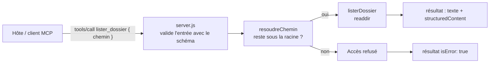

# Schéma et attendu du TP

## Version fournie

Le serveur démarre et publie l'outil `lister_dossier`, mais sans description ni schéma. Un appel renvoie `listerDossier : à implémenter`.

## Architecture à construire

Le serveur ne voit **qu'un dossier**, `bac-a-sable/` (ou celui donné en argument). Il s'exécute avec les droits de l'utilisateur : c'est donc à lui d'appliquer le moindre privilège, pas au client.

## Contrat de l'outil `lister_dossier`

### Entrée

| Champ | Type | Défaut | Rôle |
|---|---|---|---|
| `chemin` | texte | `.` | Chemin relatif au dossier autorisé, par exemple `voyages/rome` |

### Sortie

- `content` : une ligne par entrée, par exemple `[dossier] voyages`, lisible par le modèle.
- `structuredContent` : `{ chemin, entrees: [{ nom, type }] }`, où `type` vaut `dossier` ou `fichier`, conforme à l'`outputSchema`.

### Erreurs

Toutes reviennent comme un **résultat** `isError: true` avec un message lisible, jamais comme une erreur JSON-RPC.

| Situation | Message attendu |
|---|---|
| Chemin hors du dossier autorisé | `Accès refusé : « ../.. » sort du dossier autorisé` |
| Dossier inexistant | `Dossier introuvable : « voyages/tokyo »` |
| Chemin vers un fichier | `« notes.md » n'est pas un dossier` |

Un message d'erreur ne doit pas révéler de chemin absolu de la machine.

## Pistes d'implémentation

- `path.resolve(racine, chemin)` donne le chemin absolu demandé ; `path.relative(racine, cible)` dit s'il reste sous la racine (il commence alors par autre chose que `..`).
- Un chemin absolu (`C:/Windows`, `/etc`) passé à `resolve` remplace la racine : il doit être refusé lui aussi.
- Un lien symbolique placé sous la racine peut pointer ailleurs : vérifier à nouveau après `fs.realpath`.
- `readdir(dossier, { withFileTypes: true })` donne directement `entree.isDirectory()`.
- Les erreurs système portent un `code` : `ENOENT` (introuvable), `ENOTDIR` (pas un dossier).
